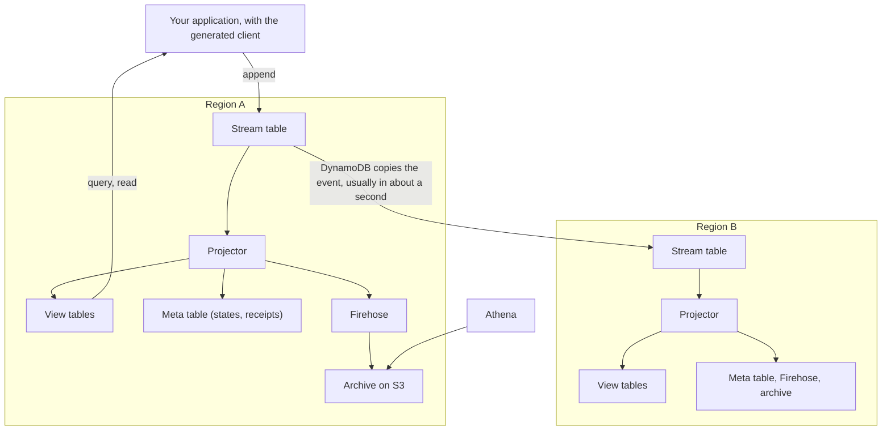

<!--
Copyright 2026 The Dynaflux Authors
SPDX-License-Identifier: Apache-2.0
-->

# Concepts

Dynaflux keeps facts, and the totals you compute from them, in DynamoDB in several AWS
regions at once. You declare streams of events, materialized views over them and named
queries in SQL. `dynaflux generate` turns them into a typed Go client and the
CloudFormation templates that run them in your AWS account.

This page explains the parts, how an event moves through them, what to expect across
regions and during an outage, and what Dynaflux doesn't do.

## The parts

- **Store.** A set of streams, views and queries with one `dynaflux.yaml`: one name, one
  list of regions, and one meta table in each region for its bookkeeping. You deploy a
  store as a unit. Each environment, such as staging or production, deploys it with its own
  prefix on every resource name.

  In Go, a `dynaflux.Store` connects generated clients to every store deployed with
  `Config.Prefix` in the region of `Config.AWS`. In SQL and in error messages, "store"
  means the definitions of one generated package, such as `store analytics`; one
  `dynaflux.Store` serves all of them.
- **Stream.** A typed collection of events that you only add to, declared with
  `CREATE STREAM`. Each stream is a DynamoDB global table, with a copy in every region of
  the store. Its `PRIMARY KEY` groups the events you read together, such as the page views
  of one user.
- **Event.** One fact, such as "user u1 opened /home at 10:02". Besides its declared
  columns, an event has four that Dynaflux sets:
  - `event_id`, unique in the stream
  - `event_time`, when the fact happened
  - `ingest_time`, when Dynaflux accepted it
  - `origin_region`, the region that accepted it
- **View.** Totals over the events of one stream, grouped by keys, such as views and
  visitors per page and day. You declare it with `CREATE MATERIALIZED VIEW`. Each region
  keeps its own copy of every view.
- **View version.** One definition of a view, always written in full, as `page_daily@v2`.
  A deployed version never changes. When you change a view, `generate` makes a new version
  with tables of its own, and a backfill fills it from past events before queries use it.
  `dynaflux.lock` records the versions.
- **Named query.** A `SELECT` with parameters, over one view or one stream, named by a
  `-- name:` comment. `generate` writes a Go method for each one. `validate` refuses a
  query that DynamoDB can't answer with key lookups and bounded range reads.
- **Projector.** A Lambda function in each region. It reads every new event of the
  region's stream tables, those written there and those copied from other regions, and
  updates the region's views and archive.
- **Archive.** Every event, kept for good in Apache Iceberg tables on S3, which Amazon Data
  Firehose writes and Athena reads. It is on by default. DynamoDB keeps an event only for
  its stream's `LOG RETENTION`, 2 days by default; after that, the archive is the only
  copy. A backfill reads it to fill a new view version.

## How an event flows

1. The application appends an event through the generated client. The client writes it
   to the stream's table in the application's region. If the stream has `SYNC` views, the
   same DynamoDB transaction also updates their rows in that region.
2. DynamoDB copies the event to the stream's table in every other region of the store,
   usually in about a second.
3. In each region, the projector receives every new event of the stream table, local or
   copied, in batches that it gathers for up to a second.
4. The projector updates that region's view tables, one table per view version. For an
   append that asked to be waited on, it writes a receipt to the meta table. It sends the
   event to Firehose, which adds it to the archive.
5. Queries read the view tables of their own region, and stream reads read the stream
   table of their own region.
6. Athena reads the archive, for any question that no named query answers.

## Regions

- **Write in any region.** An application appends in the region it opened its store in.
  It needs no other region to do so.
- **Read in your own region.** Queries and stream reads never cross regions. Each region
  answers from its own copy, even when the others are gone.
- **Views converge.** Each region's projector applies every event to that region's views.
  A view's totals don't depend on the order events arrive in, and each event counts once.
  So once every event has reached every region, every region shows the same rows.
  [sql.md §9.2](../spec/sql.md#92-what-a-view-is) lists the few exceptions.
- **Views lag.** By default a view is `ASYNC`: the projector applies events in batches. A
  view shows an append about a second later in the region that accepted it, and about a
  second after the copy arrives in each other region.
- **`SYNC` views see their own writes.** A view declared `MODE SYNC` is updated in the
  append's own transaction, in the region that accepted it. A query there sees the event
  as soon as the append returns. Other regions apply it through their projector, as for an
  `ASYNC` view. `SYNC` appends cost more and are slower, so use them for checks such as
  "is this quota used up?".
- **Waiting works in one region.** To read your own write in an `ASYNC` view, append with
  `dynaflux.Waitable()` and give the query the append's token with `dynaflux.WaitFor`. The
  wait takes about a second. Only the projector of the region that accepted the append
  writes its receipts, so the wait works only in that region.

## When a region fails

When a region stops working, the other regions keep accepting appends and answering
queries. They don't depend on each other, so nothing has to switch over.

An event that the failed region accepted, but hadn't copied yet, reaches the other regions
when the region recovers. Their views apply it then, also to past periods: the total for
10:00 can still change at 11:30.

If the region never recovers, the events it hadn't copied are lost. Copying usually takes
about a second, so these are usually the last second or so of appends in that region. A
region cut off from the others for longer than a stream's `LOG RETENTION` can also delete
events before they are copied ([sql.md §8.6](../spec/sql.md#86-log-retention)), so keep
the retention longer than any outage you plan for.

An application that runs in the failed region fails with it. To keep serving users, run
the application in more than one region, each copy with its own `dynaflux.Store`, and send
users to a region that works.

What to tell users:

- Recent totals can still change, and more so during an outage, when events from the
  failed region arrive late.
- An action confirmed shortly before a region failed may show up late, or, if the region
  is lost, not at all.
- For a fact that must not be lost, such as a payment, keep it at its source until the
  append succeeds, and give its stream a `DEDUP BY` key. The source can then send the same
  event again, to any region: if the first one arrived, the two are one event.

## Facts

- **Events never change.** Dynaflux has no update and no delete. To correct a fact, append
  another one, such as a refund after a charge. A view holds only what it computed from
  events, so a new version can recompute it from them.
- **A dedup key identifies one fact.** On a stream with `DEDUP BY`, two appends with the
  same `PRIMARY KEY` values, `event_time` and `DEDUP BY` values are the same event. The
  second one changes nothing and returns `dynaflux.ErrDuplicate`. So a retry counts once.
- **One dedup key, one payload.** An append compares only the key, not the other columns:
  - In one region, a second append with the same key and other values is still a
    duplicate. The first values stay, and the second ones are dropped.
  - In two regions at about the same time, each region accepts its own append. When the
    copies meet, the stream table keeps one, but each region's views may already count a
    different one, and then the regions disagree for good. The projector counts each such
    conflict in a metric, shown on the store's CloudWatch dashboard.

  So build the dedup key from the fact itself, such as a request ID that the client sends
  with each try, and never reuse it for another fact.

## What Dynaflux doesn't do

- **Ad-hoc queries.** Every query is named, declared in SQL and checked by `validate`, so
  each one is a key lookup or a bounded range read. To explore, query the archive with
  Athena.
- **Joins.** A view reads one stream, and a query reads one view or one stream. Combine
  results in your application, or join in Athena.
- **Updating events.** Facts never change. A view row changes only as events arrive, or
  when the view's `TTL` expires it.
- **One order across regions.** Events with the same `PRIMARY KEY` value come back in
  `(event_time, event_id)` order, the same in every region. Events written in different
  places within the clock difference of their writers, a few milliseconds, may be in
  another order than they happened. There is no check such as "append only if the last
  event is still X", since each region accepts appends without asking the others.
- **A server.** No Dynaflux server sits between your application and DynamoDB. The
  generated client calls DynamoDB itself, and the templates create everything else in your
  account.

[What a store costs](cost.md) explains where the money goes, and how to read what
`dynaflux explain` prints for your store.
